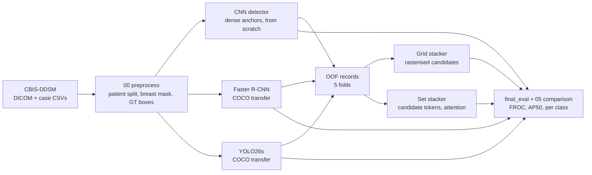

# Deep Learning Breast Cancer Detection

A final-year project that asks whether **deep learning can help read screening mammograms**.
Three object detectors localise breast masses on CBIS-DDSM, and a learned re-ranking stage
fuses their candidates before one operating point is chosen from the FROC curve. The project
compares a small from-scratch detector against COCO-pretrained detectors under a single
protocol, then asks whether learned re-ranking of all three beats the best single detector on
data no model has seen.

```text
1. **Preprocess** - clean the CBIS-DDSM metadata, split by patient, cut the breast mask and turn the lesion masks into ground-truth boxes.
2. **Detect** - train a from-scratch dense CNN, a COCO-pretrained Faster R-CNN and a COCO-pretrained YOLO26s over five out-of-fold splits.
3. **Re-rank** - train two learned stackers over the pooled out-of-fold candidates from all three detectors.
4. **Evaluate** - pick one false positive per mammogram from the FROC curve and report every model on the same held-out test set.
```

The project brief and the architecture notes are kept alongside the code but are excluded
from this public repository.

---

## Architecture



- **`00_preprocess.ipynb`** - reads the four CBIS-DDSM case-description CSVs, repairs broken DICOM paths, drops duplicates and mismatched masks, splits at patient level into 1,272 trainval and 320 test mammograms, builds the breast mask by percentile threshold and largest connected component, then caches the resized image and its box targets.
- **Detector A, `cnn_detector.py`** - a 789,692-parameter dense CNN trained from scratch. A stride-8 anchor grid over a 768x768 padded canvas gives 36,864 anchors, and each anchor predicts objectness, box deltas and a benign/malignant distribution. A stop-gradient on the way into the class branch keeps the class loss out of the shared trunk so detection cannot be disturbed by the class head.
- **Detector B, `faster_rcnn_detector.py`** - torchvision Faster R-CNN with a COCO-pretrained MobileNetV3 backbone and FPN, fine-tuned on the same inputs.
- **Detector C, `yolo_detector.py`** - Ultralytics YOLO26s, exported to the ultralytics image/label layout per fold and fine-tuned from its COCO weights.
- **The stackers** - `stacker.py` rasterises every detector's candidates onto the CNN's anchor lattice so a convolution can see where the detectors agree, while `stacker_set.py` keeps one token per candidate and lets self-attention weigh them. Both reuse the CNN's anchors, decode, NMS and losses, so a stacker metric is directly comparable with a detector metric.
- **`Detector.py` and `utility.py`** - the shared base class and one metric protocol (AP50, mAP50, per-class AP50, FROC) that all three detectors and both stackers report through, which is what makes the comparison fair.

---

## Repository structure

```text
.
├── 00_preprocess.ipynb           # DICOM cleanup, split, breast mask, box targets
├── 01_cnn_detector_mass.ipynb    # from-scratch dense CNN, 5-fold OOF
├── 02_faster_r_cnn_mass.ipynb    # Faster R-CNN (MobileNetV3-FPN), 5-fold OOF
├── 03_yolo_mass.ipynb            # YOLO26s transfer learning, 5-fold OOF
├── 04_stack_mass.ipynb           # grid and set stackers over the pooled candidates
├── 05_comparison.ipynb           # test FROC, AP50, per-class and qualitative panels
├── config.py                     # every path, hyperparameter, threshold and fold rule
├── Detector.py                   # shared detector base class and metric protocol
├── cnn_detector.py
├── faster_rcnn_detector.py
├── yolo_detector.py
├── stacker.py                    # grid stacker
├── stacker_set.py                # set stacker
├── final_eval.py                 # held-out test table (CLI)
├── final_retrain.py              # full-trainval retrain of any model (CLI)
├── utility.py                    # metrics, plotting and IO helpers
├── dataset/                      # cached mammograms (generated)
├── models/                       # fold and full checkpoints (generated)
├── 0*_workspace/                 # per-fold histories and OOF records (generated)
└── relevant_papers.md            # literature table with DOIs
```

---

## Getting started

### Prerequisites
- Python 3.11+ and [uv](https://docs.astral.sh/uv/)
- An NVIDIA GPU with a CUDA build of PyTorch (`pyproject.toml` pins the CUDA 13.2 index)
- The CBIS-DDSM collection from [The Cancer Imaging Archive](https://www.cancerimagingarchive.net/collection/cbis-ddsm/): the DICOM tree plus the four mass and calcification case-description CSVs

### 1. Install dependencies
```powershell
uv sync
```

### 2. Point `config.py` at the download
`config.py` expects the four CSVs next to a `cbis_ddsm` folder in `~/Downloads`. Change
`DOWNLOADS_FOLDER` and `ORIGINAL_DATASET_ROOT` if yours sit elsewhere.

### 3. Build the cached dataset
Run `00_preprocess.ipynb` top to bottom. It writes `mass_metadata.csv`, `calc_metadata.csv`,
`dataset/mass/` and `dataset/calc/`.

> The cached arrays and metadata CSVs rebuild from the DICOM source, so they are not tracked in git.

### 4. Train the detunder `dataset/`
Run `01_cnn_detector_mass.ipynb`, `02_faster_r_cnn_mass.ipynb` and `03_yolo_mass.ipynb`. Each
trains five folds and writes per-fold histories, checkpoints and out-of-fold detection records
to its own workspace folder.

### 5. Train the stackers
Run `04_stack_mass.ipynb`. It pools the three detectors' out-of-fold candidates and trains the
grid and set stackers on that feed.

### 6. Evaluate on the held-out test set
```powershell
uv run python final_eval.py
```
Then run `05_comparison.ipynb` for the FROC curves, the operating point table and the per-class
confusion matrices. Setting `FINAL_EVAL_LIMIT=8` runs the same path on eight mammograms as a
quick smoke test.

---

## How the evaluation works

1. **Two protocols.** Every model is reported as a five-fold ensemble (each test mammogram is scored by the fold that never saw it) and as a single full-trainval retrain.
2. **Candidates, not a shipped threshold.** Each detector exports a low score floor plus a per-image top-K feed, so the stackers receive ranked candidates instead of a pre-cut detection list.
3. **One operating point from FROC.** Sensitivity is read against false positives per mammogram, and the operating point is the last point inside one false positive per image, applied identically to every model.
4. **Ranking and localisation are separated.** AP50 and mAP50 measure ranking over all candidates; the FROC and the per-class confusion measure the localisation and benign/malignant decision at the operating point.

---

## Results

Held-out test set, 320 mammograms and 341 lesions, five-fold ensemble. Sens is sensitivity at a
budget of one false positive per mammogram.

| Model | Pretraining | AP50 | mAP50 | Sens @ 1 FP/img |
| ----- | ----------- | ---: | ----: | --------------: |
| CNN (dense anchors, 0.79M params) | from scratch | 0.493 | 0.210 | 0.601 |
| Faster R-CNN (MobileNetV3 + FPN) | COCO | 0.496 | 0.363 | 0.616 |
| YOLO26s | COCO | **0.620** | **0.433** | **0.733** |
| Grid stacker | on OOF records | 0.575 | 0.378 | 0.675 |
| Set stacker | on OOF records | 0.564 | 0.345 | 0.695 |

- The from-scratch CNN lands within 0.003 AP50 of the COCO-pretrained Faster R-CNN at roughly a twenty-fourth of its parameter count, so on this data the anchor design and losses mattered more than pretraining alone.
- The two stackers lift the ensemble well clear of the CNN and Faster R-CNN, but neither beats the COCO-pretrained YOLO26s on AP50 or mAP50. Transfer learning from natural images was worth more than the learned re-ranking stage here.
- Benign against malignant is the weak half for every model. The per-class sensitivities sit well below the class-agnostic AP50, because the class head reads features that were frozen by the stop-gradient (see `05_comparison.ipynb`).
- The full-trainval retrain gives the same ranking, so the result is not an artefact of the fold ensemble.

---

## Scope & honesty note

This is a final-year undergraduate project, built and evaluated within one academic year on a
single consumer GPU.

What's implemented:
- Patient-level preprocessing of CBIS-DDSM masses with mask-derived ground-truth boxes.
- Three detectors and two learned stackers, all reported through one metric protocol.
- Five-fold out-of-fold records, a held-out test set, and an FROC-selected operating point.

Not implemented:
- Calcification was preprocessed but never modelled. The brief covers both lesion types, and only mass was taken to completion.
- One seed per fold, so the reported means carry no confidence intervals.
- Ground truth is the bounding box of the lesion mask, which penalises a tight correct detection at IoU 0.5.
- No reader study. CBIS-DDSM carries pathology labels rather than radiologist accuracy, so the clinical comparison the brief describes is not measurable from this data alone.

---

## Tech stack

| Area | Tech |
| ---- | ---- |
| Language | Python 3.11+ |
| Deep learning | Keras 3 on the PyTorch backend, PyTorch, torchvision, Ultralytics YOLO |
| Imaging | pydicom, OpenCV, scikit-image, NumPy |
| Data and metrics | pandas, scikit-learn, SciPy |
| Tooling | Jupyter, Optuna, tqdm, Matplotlib, uv |
